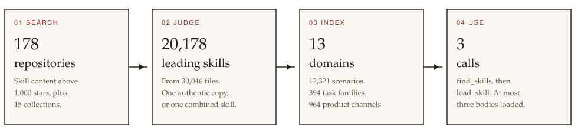
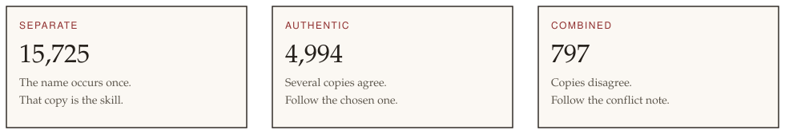

#  SkillLib

**20,178 leading agent skills, ready to search.**

SkillLib is a catalog of public Claude-compatible and Codex-compatible skills. An agent asks for a task, receives a few matching skills, and loads one procedure. The rest of the library stays out of the prompt.

MIT · Python 3.11+ · no third-party dependencies

<a href="https://github.com/DistriAI/SkillLib"> Project</a>
&nbsp;&nbsp;
<a href="https://distriai.github.io/SkillLib/"> Homepage</a>
&nbsp;&nbsp;
<a href="https://pypi.org/project/skilllib/"> PyPI</a>

```python
from skilllib import find_skills, load_skill

found = find_skills("Run GSEA on a ranked gene list")
skill = load_skill(found["cards"][0]["id"])
```



## What is in the library

The catalog is the public skill-content repositories with more than 1,000 GitHub stars, indexed on 16 October 2026. A repository qualifies when it is full of task skills (`SKILL.md`), or when it is a curated collection that points at those repositories. Skill specifications, skill SDKs, and agent products stay out of the catalog. GitHub later removed `mohitagw15856/pm-claude-skills`, and that repository is no longer indexed.

| | |
|---:|---|
| 30,046 | skill files in the source repositories |
| 20,178 | leading skills an agent can be offered |
| 178 | skill repositories, and 15 collections |
| 13 | domains, 12,321 scenarios |
| 394 | task families, 964 product channels |
| 7,503 | duplicate copies kept as variants |



Copies that share a name are judged together, and the library offers one leading skill.

A **separate** skill is the only copy of that name. An **authentic** skill is the copy to follow when several copies agree. A **combined** skill is what remains when the copies disagree: the conflict note says how to proceed, and each peer keeps its repository and path.

On a hand-labeled set of 40 tasks, the finder returned the expected skill for 36.

## Install

Python 3.11 or newer. SkillLib has no runtime dependencies.

```bash
python -m pip install skilllib
git clone https://github.com/DistriAI/SkillLib.git
cd SkillLib
```

The package provides the library and the `skilllib` command. The skill catalog is the `catalog/` directory in the git repository. Commands and the Python functions read that directory from the current working directory, so run them from a checkout.

To work on this checkout, install it in place with `python -m pip install -e .`, or use it without installing:

```bash
export PYTHONPATH=src
python -m skilllib find "Run GSEA on a ranked gene list"
```

## Get the skill files

The git checkout holds the catalog and the routing cards. The procedure text and the repository checkouts are published separately as [DistriAI/skillLib](https://huggingface.co/datasets/DistriAI/skillLib). Download that dataset once, into this checkout, before loading a skill or handing the tools to an agent:

```bash
python -m pip install -U huggingface_hub
hf download DistriAI/skillLib --repo-type dataset --local-dir cache
```

That writes `cache/skills/` (one `SKILL.md` per catalog path) and `cache/repos/` (one checkout per skill repository). `find` reads the cards in `catalog/`. `load` reads the procedure from `cache/skills/` and the bundled scripts and references from `cache/repos/`. A directory restored this way is a checkout, including one that arrives without a `.git` folder.

Each upstream repository keeps its own license, listed in the dataset manifest. The dataset license is `other`. The SkillLib MIT license does not cover those files.

If `HF_ENDPOINT` points at a mirror, set `HF_ENDPOINT=https://huggingface.co` for this download. Details of the two trees are in [docs/huggingface.md](docs/huggingface.md).

## Find and load a skill

```bash
skilllib find "Run GSEA on a ranked gene list"
skilllib load combined::gsea
skilllib prompt --working-set catalog/working_set.example.json
```

`find_skills` returns a few cards for the task: name, description, when to use the skill, when not to, and where it came from. Pass a domain to search one shelf, for example `find_skills(task, domain="science")`. `load_skill` returns the procedure. Before either one downloads a skill file, it looks in the project's `cache/` and then in the directory named by `skilllib.json` at the checkout root:

```json
{
  "cache": "/path/to/skilllib-cache"
}
```

`cache` may be absolute, or relative to the checkout. That directory has the same layout as a Hugging Face restore: `<cache>/skills` and `<cache>/repos`. A file found there is used as it is. `download`, `visit`, and `prefetch` still write into the project's `cache/`. `render_prompt` writes the standing prompt for those Python function names: one sentence for each of the 13 domains, an instruction to search before deciding that no skill applies, and a cap of three loaded bodies.

The same shelves are on the [homepage](https://distriai.github.io/SkillLib/). Open a domain, then its [task families](https://distriai.github.io/SkillLib/library/families/). A family lists skill cards. A card opens the skill page. [All domains](https://distriai.github.io/SkillLib/library/) also lists scenarios.

| Domain | Scenarios | Skills |
|---|---:|---:|
| [research](https://distriai.github.io/SkillLib/library/research/) | 1,510 | 4,962 |
| [science](https://distriai.github.io/SkillLib/library/science/) | 1,592 | 2,424 |
| [software-engineering](https://distriai.github.io/SkillLib/library/software-engineering/) | 1,643 | 2,077 |
| [security](https://distriai.github.io/SkillLib/library/security/) | 1,387 | 1,744 |
| [business](https://distriai.github.io/SkillLib/library/business/) | 1,108 | 1,591 |
| [agent-tooling](https://distriai.github.io/SkillLib/library/agent-tooling/) | 846 | 1,429 |
| [marketing](https://distriai.github.io/SkillLib/library/marketing/) | 898 | 1,253 |
| [devops](https://distriai.github.io/SkillLib/library/devops/) | 913 | 1,086 |
| [data](https://distriai.github.io/SkillLib/library/data/) | 641 | 827 |
| [design](https://distriai.github.io/SkillLib/library/design/) | 564 | 822 |
| [general](https://distriai.github.io/SkillLib/library/general/) | 420 | 760 |
| [media](https://distriai.github.io/SkillLib/library/media/) | 429 | 664 |
| [documents](https://distriai.github.io/SkillLib/library/documents/) | 370 | 539 |

## Integrate an agent

An agent runtime takes the prompt and the tool descriptions from `skilllib.integrate`: `tool_specs()`, `resident_prompt()`, `task_instruction()`, and `call_tool()`. Register the specs under the names they already carry (`skill_library_find`, `skill_library_load`, `skill_library_visit`), append `resident_prompt()` to the system prompt, and return `call_tool(name, arguments, root=checkout)` to the model. The field reference is [docs/interface.md](docs/interface.md).

An agent that already has `skill_view` (Hermes), or the Claude or Codex skill loader, should keep that tool. It opens a skill installed on the machine, including its scripts and references. SkillLib answers the earlier question: which skill from this library is worth installing. `load_skill` can show the cached text before that install. When the skill names bundled files that are still absent from the checkout, the tool result names the repository to visit. A named file counts as checked out when it is anywhere in that repository. A combined skill returns the peers that are present.

## Add a repository

New repositories merge into the catalog. A later search keeps the 1,000-star collection.

```bash
python -m skilllib add owner/name
python -m skilllib search --min-stars 500 --merge
python -m skilllib update
```

`search`, `add`, and `update` call GitHub. `update` judges a name again only when a copy joins it, leaves it, or a stored skill file changes. It downloads the skill files in an overlapping name, writes a card for each new leading skill, and fills a thin card when that file is already on disk. Judging a new overlap uses the OpenAI-compatible endpoint in `catalog/judge_config.json` (`SKILLLIB_LLM_BASE_URL`, `SKILLLIB_LLM_MODEL`, and `SKILLLIB_LLM_API_KEY` override it). `update --judge heuristic` judges from the repository metadata alone.

A skill name that occurs only in the repository just added is absent from that download. Its card keeps an empty description until the file is fetched and read. From the repository root, after `update`:

```bash
python -m skilllib download --leaders
python -m skilllib cards
python -m skilllib link
python -m skilllib enrich
```

Each command skips work already stored. `download --leaders` fetches the `SKILL.md` behind every leading skill. Exit code 2 means some fetches failed; run the command again to retry those files. `cards` copies the description and scope out of each new file. `link` records `requires`, `alternative`, and `follows`. `enrich` asks the model in `catalog/judge_config.json` to fill a field the file never states. A saved fill is reused. Exit code 2 means some cards failed; run `enrich` again to retry them.

Rebuild the task families when the shelves should be collapsed again. That stays a separate command, because re-collapsing every domain on each added repository is expensive:

```bash
python -m skilllib families --name-with heuristic
```

Regenerate the HTML shelf with `python -m skilllib browse`. The pages are under `docs/library/`.

## Refresh the caches from GitHub

The Hugging Face dataset is the copy to download. `prefetch` is how that copy is rebuilt: it clones every catalog skill repository into `cache/repos/`. A checkout already on disk is skipped.

```bash
python -m skilllib prefetch --workers 4
```

Exit code 2 means some clones failed. Retry those names with `python -m skilllib prefetch --failed`. That reads `catalog/prefetch_status.json` and leaves the successful checkouts in place. Add `--protocol ssh` to clone with `git@github.com` and an SSH key already registered with GitHub. The default is HTTPS. Run `prefetch` again, without `--failed`, after a repository is added to the catalog. `visit owner/name` clones one repository. The list of finished checkouts is `cache/repos/manifest.json`.

`python -m skilllib publish --repo DistriAI/skillLib` writes the dataset card for `cache/repos/` and `cache/skills/`. Add `--upload` to send it. The card license is `other`. Repositories and skill files that could not be fetched are named in the card.

## Commands

The first command fills `cache/` from the Hugging Face dataset. The others run from the repository root as `skilllib <command>`, or as `python -m skilllib <command>`. Full arguments are in [docs/interface.md](docs/interface.md). The stage log for the first catalog is in [docs/history.md](docs/history.md).

| Command | What it does |
|---|---|
| `hf download DistriAI/skillLib --repo-type dataset --local-dir cache` | Download the skill files and repository checkouts into `cache/`. |
| `find "..."` | Return a few routing cards for a task. |
| `load <id>` | Print the cached procedure for one card. |
| `prompt` | Write the standing prompt fragment. |
| `visit owner/name` | Clone one repository into `cache/repos/`. `--protocol ssh` uses an SSH key. |
| `list` | Print the saved catalog. |
| `browse` | Write the HTML shelf under `docs/library/`. |
| `add owner/name` | Inspect one repository and merge it into the catalog. |
| `search` | Find skill repositories on GitHub. `--merge` keeps the ones already stored. |
| `update` | Index skills added or edited since the last update. |
| `download --leaders` | Fetch the `SKILL.md` for every leading skill. |
| `cards` | Copy the description and scope out of each new skill file. |
| `link` | Record `requires`, `alternative`, and `follows`, and refresh checkout gaps. |
| `enrich` | Fill a card field the skill file never states. |
| `families` | Collapse the current cards into families again. |
| `prefetch` | Clone every catalog skill repository into `cache/repos/`. `--failed` retries only the names recorded as failed. `--protocol ssh` uses an SSH key. |
| `publish --repo owner/dataset` | Write the Hugging Face dataset card for `cache/repos/` and `cache/skills/`. `--upload` sends it with `hf upload`. |

`screen`, `download`, `index`, `cards`, `enrich`, and `link` can also run as a single stage. After `add` and `update`, run `download --leaders`, `cards`, `link`, and `enrich` so a skill name that occurs once gets a full card. `update` covers names that overlap a skill already in the catalog.

## License

This project is [MIT licensed](LICENSE). Skill files collected from other repositories keep the license recorded for each repository in the catalog.
